<picture>
  <source media="(prefers-color-scheme: dark)" srcset="./assets/banner-dark.svg">
  
</picture>

 

## ( chi siamo )

**GS LOFT** è il metodo creato da Giacomo Spazzini per aumentare **longevità, benessere psicofisico e performance**.

Un percorso guidato dalla scienza e costruito su misura, con un team di medici, nutrizionisti, coach e trainer che lavorano insieme.

Dal 2019 &nbsp;·&nbsp; Desenzano del Garda e Milano

 

## ( il metodo )

<picture>
  <source media="(prefers-color-scheme: dark)" srcset="./assets/metodo-dark.svg">
  
</picture>

 

## ( dev )

Qui il team sviluppa gli **strumenti interni** che sostengono il metodo: dashboard, automazioni e integrazioni tra dati, preventivi e servizi.

<picture>
  <source media="(prefers-color-scheme: dark)" srcset="./assets/dev-dark.svg">
  
</picture>

<!-- progetti:inizio -->
| | Progetto | Cosa fa | Aggiornato |
|:--|:--|:--|:--|
| **Dashboard** | [`Portale-Sales`](https://github.com/GS-Loft-Dev/Portale-Sales) | Performance del team sales con i dati di HubSpot | 25 nov 2026 |
|  | `dash-previntegratori` | Preventivi degli integratori, collegati a Google Fogli | 25 nov 2026 |
| **Automazioni** | `GS-Bot-Discord` | Bot del team: invio del Bio Profilo e dello Starter Check e altre automazioni | 25 nov 2026 |
|  | `BIO_Profilo` | Bio Profilo dei clienti | 25 nov 2026 |
|  | `lovableTOhubspot` | Pubblicazione automatica delle landing Lovable su HubSpot | 25 nov 2026 |
| **AI** | `gs-mind-memoria` | La memoria dell'assistente GS Mind | 25 nov 2026 |
|  | `assistenteLOFT` | Assistente AI del team, con permessi diversi per ogni utente | 25 nov 2026 |
| **Strumenti** | [`PortaleQuiz`](https://github.com/GS-Loft-Dev/PortaleQuiz) | Quiz a tempo e survey interne per il team | 25 nov 2026 |
| **Dati** | `data_management_project` | Centralizzazione dei dati di HubSpot e dei database interni | 25 nov 2026 |
| **Altro** | [`luvhub`](https://github.com/GS-Loft-Dev/luvhub) nuovo | In sviluppo | 25 nov 2026 |
|  | [`restyling-web`](https://github.com/GS-Loft-Dev/restyling-web) nuovo | In sviluppo | 25 nov 2026 |

11 progetti, 7 privati: li vedono solo i membri dell'organizzazione. Elenco aggiornato da solo da una GitHub Action.
<!-- progetti:fine -->

 

<picture>
  <source media="(prefers-color-scheme: dark)" srcset="./assets/attivita-dark.svg">
  
</picture>

 

## ( contatti )

<table>
  <tr><td><b>Sito</b></td><td><a href="https://www.gsloft.it">gsloft.it</a></td></tr>
  <tr><td><b>Email</b></td><td><a href="mailto:info@gsloft.it">info@gsloft.it</a></td></tr>
  <tr><td><b>Social</b></td><td><a href="https://www.instagram.com/gs_loft">Instagram</a> &nbsp;·&nbsp; <a href="https://it.linkedin.com/company/gsloft">LinkedIn</a> &nbsp;·&nbsp; <a href="https://www.facebook.com/gspazziniloft">Facebook</a></td></tr>
  <tr><td><b>Lavora con noi</b></td><td><a href="https://www.linkedin.com/company/gsloft/jobs/">posizioni aperte</a></td></tr>
</table>
