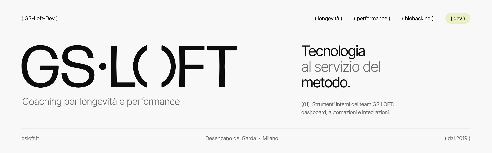

<picture>
  <source media="(prefers-color-scheme: dark)" srcset="./assets/banner-dark.png">
  
</picture>

 

## ( chi siamo )

**GS LOFT** è il metodo creato da Giacomo Spazzini per aumentare **longevità, benessere psicofisico e performance**.

Un percorso guidato dalla scienza e costruito su misura, con un team di medici, nutrizionisti, coach e trainer che lavorano insieme.

Dal 2019 &nbsp;·&nbsp; Desenzano del Garda e Milano

 

## ( il metodo )

Sette pilastri, un solo percorso.

<table>
  <tr><td><code>01</code>&nbsp; Prevenzione e test di precisione</td><td><code>05</code>&nbsp; Mindset e gestione dello stress</td></tr>
  <tr><td><code>02</code>&nbsp; Allenamento</td><td><code>06</code>&nbsp; Ottimizzazione del sonno</td></tr>
  <tr><td><code>03</code>&nbsp; Nutrizione</td><td><code>07</code>&nbsp; Gestione del tempo</td></tr>
  <tr><td><code>04</code>&nbsp; Nutraceutica</td><td></td></tr>
</table>

 

## ( dev )

Qui il team sviluppa gli **strumenti interni** che sostengono il metodo: dashboard, automazioni e integrazioni tra dati, preventivi e servizi.

| Progetto | Cosa fa |
|:--|:--|
| **dash-previntegratori** | Dashboard dei preventivi degli integratori, collegata a Google Fogli |

I repository sono privati: li vedono solo i membri dell'organizzazione.

 

## ( contatti )

<table>
  <tr><td><b>Sito</b></td><td><a href="https://www.gsloft.it">gsloft.it</a></td></tr>
  <tr><td><b>Email</b></td><td><a href="mailto:info@gsloft.it">info@gsloft.it</a></td></tr>
  <tr><td><b>Social</b></td><td><a href="https://www.instagram.com/gs_loft">Instagram</a> &nbsp;·&nbsp; <a href="https://it.linkedin.com/company/gsloft">LinkedIn</a> &nbsp;·&nbsp; <a href="https://www.facebook.com/gspazziniloft">Facebook</a></td></tr>
  <tr><td><b>Lavora con noi</b></td><td><a href="https://www.linkedin.com/company/gsloft/jobs/">posizioni aperte</a></td></tr>
</table>
